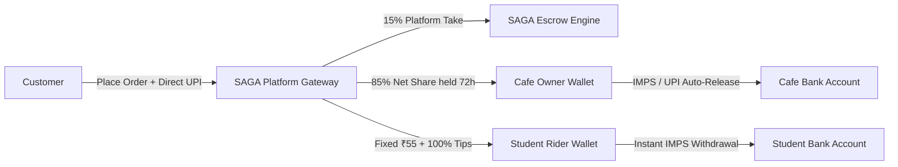
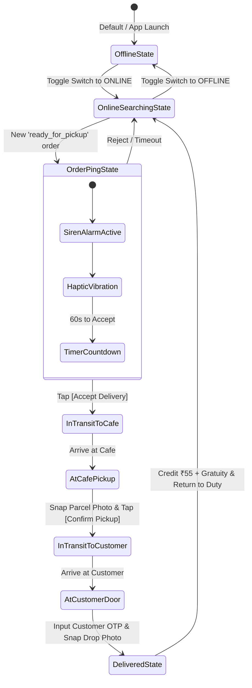

# SAGA Platform — Product Requirements Document (PRD)
**Version:** 2.4.0 • **Status:** Production Live & Staged for Rider PWA Overhaul  
**Target URL:** [https://saga-platform.vercel.app](https://saga-platform.vercel.app) • **Target Market:** Koramangala & Bengaluru Campus Hubs  
**Author:** SAGA Engineering & Product Architecture Team • **Last Updated:** November 22, 2026

---

## 1. Executive Summary & Platform Mission

**SAGA Platform** is a premier hyperlocal food delivery and artisan kitchen network built specifically for modern Indian college campuses and urban foodie hubs, starting in Koramangala, Bengaluru. 

Unlike traditional predatory aggregators that charge 25%–35% commissions and inflate dish prices, SAGA operates on a **15% transparent take-rate**, guarantees genuine cafe-menu pricing, empowers **college student couriers** with flexible high-paying campus gigs (guaranteed ₹55+ per drop + 100% tip retention), and enforces automated **72-hour (3-day) escrow payouts** directly into cafe owner bank accounts.



This PRD establishes:
1. **The Comprehensive Baseline:** Everything designed, built, tested, and live in production across the Customer Storefront, Cafe Owner POS, Admin Console, and Database.
2. **The Rider PWA Specification:** Detailed requirements for the student courier PWA overhaul — including Offline/Online state management, Real-Time dispatch audio alarm sirens, zero-state empty views, and in-transit verification.

---

## 2. Core Architecture & Technology Stack

| Layer | Technology | Key Implementations |
| :--- | :--- | :--- |
| **Frontend Framework** | **Next.js 16 (App Router)** | Partial Prerendering (PPR), Turbopack/Webpack compiler, Server/Client components. |
| **Styling & Design** | **Tailwind CSS v4** | Minimalist White & Emerald Green (`#10B981`) theme, responsive drawer sheets, haptic feedback CSS tokens. |
| **Language & Types** | **TypeScript 5.8** | Strict typing across orders, wallets, transactions, promos, and KYC entities. |
| **State & Persistence** | **Hybrid Local-Cloud Sync** | LocalStorage persistence with reactive `window.dispatchEvent` custom events (`SAGA_ORDERS_EVENT`, `SAGA_CONFIG_EVENT`, `SAGA_PROMO_EVENT`, `SAGA_RATINGS_EVENT`). |
| **Backend & Realtime** | **Supabase Postgres** | PostgreSQL tables with Realtime WebSocket channels (`saga-realtime-global`, `postgres_changes`). |
| **Audio Feedback** | **Web Audio API** | Dual-tone status chimes, camera shutter synthesis, kitchen bell alarms, and celebration chords (zero network audio files). |
| **PWA Capability** | **Web App Manifest + SW** | Standalone mobile display, icons, service worker asset caching, and mobile browser address bar theming. |

---

## 3. Live Production Feature Audit (Completed Capabilities)

### 3.1 Customer Storefront & Dynamic Checkout
* **Artisan Catalog & Visual Storefront (`/`, `/cafe/[slug]`):**
  * Multi-outlet cafe discovery with live preparation times, badges, and veg/non-veg indicators.
  * Active order in-transit top alert banner with live route link.
* **Smart Multi-Address & Distance Delivery Fee Engine (`components/CartDrawer.tsx`, `lib/services/addressService.ts`):**
  * User can store and switch multiple addresses (**Home**, **Work**, **Hostel**, **Other**).
  * **Dynamic Delivery Fee Math:**
    $$\text{Delivery Fee} = \begin{cases} ₹25 & \text{if } \text{distance} \le 5\text{ km} \\ ₹25 + (\text{distance} - 5) \times ₹6/\text{km} & \text{if } 5\text{ km} < \text{distance} \le 10\text{ km} \\ \text{BLOCKED (Out of Range)} & \text{if } \text{distance} > 10\text{ km} \end{cases}$$
  * **Minimum Order Value (MOV):** Enforces a strict minimum of **₹200** subtotal (dynamically configurable by Admin). Orders below MOV are blocked with an itemized *"Add ₹XX more"* alert.
* **Direct UPI & Doorstep COD Payment Modes:**
  * **Direct UPI Intent:** 1-tap mobile payment link to GPay / PhonePe / Paytm with zero gateway convenience surcharges.
  * **Paytm Standee QR Code:** In-drawer merchant QR standee for laptop/tablet desktop scanning.
  * **Doorstep COD:** Choice of physical cash or doorstep UPI on arrival.
* **Dynamic Promo Codes & Coupons Engine (`lib/services/promoService.ts`):**
  * Instant uppercase coupon code validation and application.
  * Clickable quick-offer chips (`SAGA50`, `CAMPUS20`, `WELCOME20`).
  * Itemized bill summary deduction showing discount amount saved.
* **Live Order Delivery Tracking (`/orders/[id]`):**
  * Interactive route map showing Cafe coordinates, Customer coordinates, and live Student Rider position.
  * 4-Digit Handover OTP display card with strict no-cancellation guarantees.
  * Visual stepper timeline: *Placed → Preparing → Ready for Pickup → Out for Delivery → Delivered*.
  * Courier parcel proof photos (Cafe pickup parcel photo & Doorstep delivery drop photo).
  * 1-Click WhatsApp delivery notification updates.
* **Customer Feedback, Rating & Gratuity Card (`app/orders/[id]/OrderTrackingView.tsx`):**
  * When an order status transitions to `delivered`, the tracking screen surfaces an interactive feedback card:
    * **Food Taste & Packaging:** 1 to 5 interactive ★★★★★ stars.
    * **Student Courier Experience:** 1 to 5 interactive ★★★★★ stars.
    * **Student Courier Tip Gratuity:** 1-tap pills (**No Tip**, **₹10**, **₹20**, **₹30**, **₹50**, **Custom**).
    * **Dynamic Ledger Reflection:** 100% of the tip is credited directly to the student rider's wallet balance with an immutable `rider_earning` audit transaction.

---

### 3.2 Merchant POS & Kitchen Display System (`/merchant`)
* **Multi-Outlet Cafe Isolation:**
  * Header dropdown switching between all network cafes (e.g., *Saga Cafe Koramangala*, *Indiranagar*, *HSR Layout*).
  * Scope toggle: *This Cafe* vs. *All Network Cafes*.
* **Live Kitchen Display & Preparation Flow:**
  * Real-time kitchen bell audio alerts on new incoming orders (`sounds.playKitchenBellAlert()`).
  * 1-Click action buttons: `[Accept Order]` → `[Ready for Pickup]`.
* **Menu Catalog & Availability Controls:**
  * Add new dishes with photos, price, category, and veg/non-veg status.
  * 1-Click dish stock toggle (`In Stock` vs `Sold Out`).
* **KYC Compliance & Verification:**
  * Form for FSSAI 14-digit food license and 15-character GSTIN tax number with verification status.
* **1-Click Daily Sales & Tax Reconciliation Export (Excel / CSV):**
  * Generates an accounting CSV: `Date, Time, Order ID, Order Number, Cafe Name, Customer, Dishes, Subtotal, Coupon, Discount, Delivery Fee, Platform Fee, Gross Total, 15% Take-Rate, Net Cafe Payout, Rider Fee, Payment Method, Delivery Status, OTP`.
  * **Admin Pro Feature Gate:** Only enabled when Admin toggles `allowMerchantCsvExport: true`. When disabled, displays a locked badge `[Export Daily Sales 🔒 PRO]` which opens a Pro upgrade dialog with WhatsApp support.
* **Store Promos & Offers Tab:**
  * Cafe owners can launch exclusive offers for their specific kitchen (e.g. `KORAMANGALA100`).
* **Wallet & Escrow Balance Ledger:**
  * Displays Available Balance vs. 72-Hour Escrow On-Hold Balance.
  * Instant Bank IMPS & UPI withdrawal requests with bank account validation.

---

### 3.3 Platform Admin Command Center (`/admin`)
* **Live Platform Orders & Logistics Dispatch Monitor:**
  * Full real-time table of all network orders with multi-attribute filtering (Cafe, Search query, Status).
  * 1-Click `📥 Export Sales & Tax CSV` button for platform-wide financial reconciliation.
  * **Order Detail Modal:** Comprehensive modal featuring:
    * `[Prev]` and `[Next]` keyboard arrow order flipping.
    * 4-column financial math card (Subtotal, 85% Cafe Share, ₹55 Rider Courier Fee, 15% Platform Take).
    * Delivery handover OTP and courier verification photos.
* **Campus Couriers & Fleet Directory Tab:**
  * Roster of student riders with college name, vehicle type, live duty status, wallet balance, and floating cash-in-hand accounting.
* **Dynamic App Control Center (Zero-Downtime Hot Config):**
  * Real-time sliders for Minimum Order Value (MOV), Base Delivery Fee, Base Radius, Extra Fee per km, Max Delivery Radius, Rider Payout (₹55), and COD Cash Limit.
  * Dynamic Storefront Announcement Banner editor with live theme preview (Warning, Alert, Celebration, Info).
  * Pro Monetization Toggle: `"Allow Cafe Owners to Download Daily Sales & Tax CSV"`.
  * **Promo Codes & Discount Coupons Console:** Create, toggle active/inactive, view redemptions, and delete coupon codes live to production.
* **3-Day Settlement Escrow Engine:**
  * 72-hour escrow hold manager for merchant funds.
  * Automated batch execution releasing matured credits into available balances with downloadable bank advice CSV.

---

## 4. Target Feature Specification: Next-Gen Student Courier Rider PWA

The student courier rider experience is critical to SAGA's unit economics and speed. This section establishes the complete technical specification for the upcoming Rider PWA overhaul.



---

### 4.1 Rider State Machine (Online vs. Offline)

#### Problem Statement
Currently, the rider screen displays static order numbers and does not clearly distinguish between an idle courier ready for drops and an offline student studying for exams.

#### Functional Requirements
1. **Prominent Online / Offline Toggle Switch:**
   * Located at the top-right of the rider app header.
   * State persisted in `localStorage` under `saga_rider_online_status_v1` and synced to Supabase profile (`is_online: boolean`).
   * Haptic vibration confirmation (`[40, 60, 40]`) on toggle transition.
2. **Dedicated Offline Home Screen UI (`isOnline === false`):**
   * **Hero Status Card:** Displays a large power icon, `"You are Currently Offline"`, and subtitle `"Turn your toggle ON to start receiving delivery pings from nearby cafes."`
   * **Shift Summary Widget:** Today's completed drops, shift earnings, and rating.
   * **Battery Saver Protocol:** When offline, all background polling, geolocation tracking, and Supabase channel subscriptions for new drops are suspended to save student device battery.
   * **One-Tap Re-activation:** Large emerald CTA `"Go Online & Start Earning"`.
3. **Dedicated Online Searching UI (`isOnline === true`):**
   * **Live Radar Beacon:** Pulsing emerald radar graphic indicating active duty.
   * **Location Pill:** `"Connected to Koramangala Hub • Active Dispatch Listener"`.
   * **Available Drops Section:** Dynamically updates when cafes mark orders as `ready_for_pickup`.

---

### 4.2 Real-Time Dispatch Alert & Audio Siren / Alarm System in PWA

#### Problem Statement
When riding an electric scooter or bicycle, riders keep their phone in their pocket or mounted on handlebars. Subtle chimes are easily missed in traffic.

#### Functional Requirements
1. **Synthesized High-Decibel Siren / Alarm (`SoundEffectsManager`):**
   * Uses Web Audio API to generate a repetitive two-tone high-pitch siren (880 Hz alternating with 1200 Hz at 150ms intervals).
   * Repeats for up to 60 seconds or until the rider interacts with the notification.
   * Self-contained: Requires zero network requests, audio downloads, or external MP3 files.
2. **Haptic Vibration Pattern:**
   * Continuous urgent vibration sequence using the HTML5 Vibration API: `navigator.vibrate([300, 150, 300, 150, 600, 200])`.
3. **Full-Screen Incoming Order Card (Modal Overlay):**
   * **60-Second Countdown Timer Bar:** Visual animated progress bar showing remaining time to accept.
   * **Pickup Details:** Cafe name, distance from rider (e.g. *0.8 km*), address.
   * **Dropoff Details:** Customer area (e.g. *Koramangala 5th Block, 2.4 km away*).
   * **Earnings Guarantee Badge:** `"Earn ₹55.00 guaranteed upon handover"`.
   * **Actions:** Large green `[ACCEPT DELIVERY]` button vs. secondary `[DECLINE]` button.

---

### 4.3 Order History & Dynamic Zero-State (Empty State) UX

#### Problem Statement
The current rider wallet view has hardcoded mock drops (`drop-1`, `drop-2`), which confuse new riders who haven't completed any deliveries yet.

#### Functional Requirements
1. **Dynamic Shift History:**
   * Pulls strictly from `saga_platform_orders_v3` where `rider_id === currentRider.id` and `status === 'delivered'`.
2. **Pristine Zero-State UI (When `deliveredOrders.length === 0`):**
   * Removes all dummy drop rows and empty transaction tables.
   * Displays an illustrated, friendly zero-state card:
     * Graphic: Delivery backpack / scooter illustration.
     * Title: *"No deliveries completed yet today"*.
     * Subtitle: *"Go Online to receive your first campus drop! Each completed delivery credits ₹55.00 instantly to your balance."*
3. **Populated Shift History UI (When `deliveredOrders.length > 0`):**
   * Each delivered card shows:
     * Order number (e.g., `#SAGA-4829`)
     * Timestamp (e.g., *18:24 IST*)
     * Cafe name & customer delivery area
     * Base courier payout (`+₹55.00`)
     * Customer gratuity tip (if given by customer, highlighted in emerald: `+₹20.00 Tip`)
     * Payment collection mode (`Online UPI` vs `₹350 Cash Collected`)

---

### 4.4 In-Transit Trip Lifecycle & Proof Verification

#### Step-by-Step State Flow:
1. **Step 1: Heading to Cafe (`tripStep === 'to_cafe'`):**
   * Displays Cafe address, navigation button opening Google Maps with coordinates.
   * 1-Click button to call cafe manager if order isn't ready.
   * Action button: `[ARRIVED AT CAFE]`.
2. **Step 2: Pickup Verification (`tripStep === 'at_cafe'`):**
   * Camera Proof: Rider snaps photo of sealed package with SAGA receipt.
   * Action button: `[CONFIRM PICKUP & START TRIP]`.
   * Automatically updates order status in Supabase to `out_for_delivery` and alerts customer tracking screen.
3. **Step 3: Heading to Customer (`tripStep === 'picked_up'`):**
   * Displays customer drop address, distance, and 1-click Google Maps navigation.
   * 1-Click masked phone call to customer.
4. **Step 4: Doorstep Handover & 4-Digit OTP Verification:**
   * Rider must ask customer for their secret 4-digit Delivery OTP (generated at order placement).
   * Keypad input: Validates against `order.delivery_otp`. If incorrect, shows warning and blocks completion.
   * Delivery Drop Photo: Snaps confirmation photo of customer handover.
5. **Step 5: Completion & Instant Payout Credit:**
   * Status updates to `delivered`.
   * ₹55 Courier fee + Customer tip credited instantly to rider wallet.
   * Haptic celebration vibration and audio chime.

---

## 5. Database Schema & Data Models Specification

```
                          ┌───────────────────────────┐
                          │         cafes             │
                          │───────────────────────────│
                          │ id: uuid (PK)             │
                          │ name: text                │
                          │ address: text             │
                          │ commission_rate: numeric  │
                          └─────────────┬─────────────┘
                                        │ 1
                                        │
                                        │ N
┌───────────────────────────┐           ▼           ┌───────────────────────────┐
│         profiles          │     ┌───────────┐     │        menu_items         │
│───────────────────────────│     │  orders   │     │───────────────────────────│
│ id: uuid (PK)             │1   N│───────────│N   1│ id: uuid (PK)             │
│ role: user_role           ├────►│ id (PK)   │◄────┤ cafe_id: uuid (FK)        │
│ full_name: text           │     │ status    │     │ name: text                │
│ phone: text               │     │ otp       │     │ price_inr: numeric        │
│ is_online: boolean        │     │ items     │     └───────────────────────────┘
└─────────────┬─────────────┘     └─────┬─────┘
              │ 1                       │ 1
              │                         │
              │ 1                       │ N
              ▼                         ▼
┌───────────────────────────┐     ┌───────────────────────────┐
│         wallets           │1   N│    wallet_transactions    │
│───────────────────────────│────►│───────────────────────────│
│ id: uuid (PK)             │     │ id: uuid (PK)             │
│ user_id: uuid (FK)        │     │ wallet_id: uuid (FK)      │
│ balance_inr: numeric      │     │ order_id: uuid (FK)       │
│ on_hold_balance_inr: num  │     │ amount_inr: numeric       │
└───────────────────────────┘     │ type: transaction_type    │
                                  └───────────────────────────┘
```

---

## 6. PWA Standards, Security & Offline Resilience

1. **PWA Manifest Standards (`public/manifest.json`):**
   * `short_name`: *"SAGA Courier"*
   * `start_url`: `"/rider"`
   * `display`: `"standalone"`
   * `theme_color`: `"#10B981"`
   * `background_color`: `"#0F172A"`
2. **Audio Autoplay Permission Protocol:**
   * On mobile Chrome/Safari, audio playback requires prior user interaction.
   * The first time the rider toggles **ONLINE**, SAGA initializes and unlocks the `AudioContext` instance (`ctx.resume()`), guaranteeing that subsequent order ping alarm sirens can fire without browser blocking.
3. **Edge Case Safety Protocols:**
   * **App Closed During Delivery:** Active trip state (`saga_rider_active_order_v1`, `saga_rider_trip_step_v1`) persists in local storage. Reopening the app or PWA immediately restores the active delivery screen without loss of progress.
   * **Network Loss During Handover:** In-app OTP verification checks against cached order state, allowing successful delivery confirmation and queueing transaction sync for when connectivity restores.

---

## 7. QA Acceptance Criteria Checklist

| Role | Scenario / Action | Expected Result | Verified Status |
| :--- | :--- | :--- | :--- |
| **Customer** | Add dishes $< ₹200$ | Checkout button blocked with *"Add ₹XX more for Min Order"* | ✅ Pass |
| **Customer** | Enter coupon `SAGA50` | Deducts ₹50 from bill subtotal with green badge | ✅ Pass |
| **Customer** | Distance $> 10$ km | Delivery blocked with *"Location Beyond 10 km"* | ✅ Pass |
| **Customer** | Order Delivered | 5-Star food rating, 5-Star rider rating, tip pills display | ✅ Pass |
| **Merchant** | New Order Placed | Kitchen bell rings, order appears in *Live POS* | ✅ Pass |
| **Merchant** | Click Export CSV | If Pro enabled: downloads CSV; If locked: opens Pro modal | ✅ Pass |
| **Merchant** | Create Cafe Coupon | Coupon live immediately on customer storefront for that cafe | ✅ Pass |
| **Rider** | Toggle OFFLINE | Polling pauses, offline hero card renders, zero battery drain | 🟡 Next Up |
| **Rider** | New Order Assigned | Loud siren alarm sounds, modal with 60s countdown opens | 🟡 Next Up |
| **Rider** | Verify OTP | Correct 4-digit code required to finalize delivery | ✅ Pass |
| **Rider** | Zero Deliveries | Shows clean illustrated zero-state (no dummy drops) | 🟡 Next Up |
| **Admin** | Flip Orders in Modal | `[Prev]` and `[Next]` flip orders smoothly with financial math | ✅ Pass |
| **Admin** | Export Platform CSV | Generates comprehensive Excel/CSV reconciliation sheet | ✅ Pass |
| **Admin** | Adjust MOV Slider | Storefront MOV rules update immediately without redeploy | ✅ Pass |

---

*Document approved by SAGA Engineering for production reference and PWA testing.*
